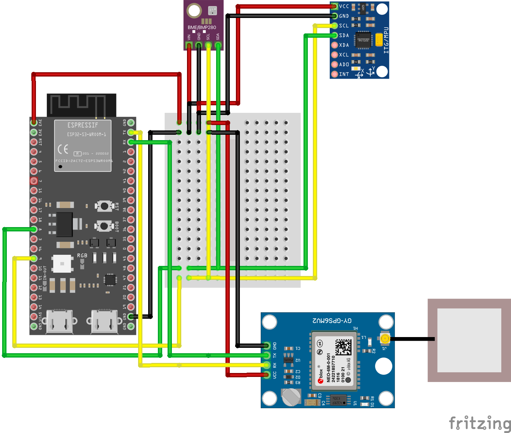
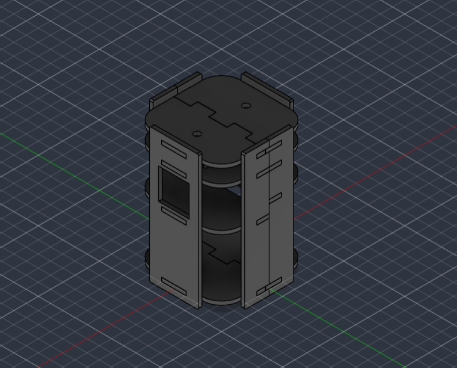

# OpenCanSat Hardware

This directory contains the electrical connections, component list, and mechanical design files for the OpenCanSat ESP32-S3 prototype.

## Hardware Overview

| Component | Model | Function |
|---|---|---|
| Microcontroller | ESP32-S3 | Data acquisition and USB serial communication |
| IMU | MPU6050 | 3-axis acceleration and angular velocity |
| Environmental sensor | BME280 | Temperature, humidity, and atmospheric pressure |
| GPS receiver | NEO-6M | Position and GPS altitude |

See the [Bill of Materials](BOM.csv) for the complete component list.

## Wiring Diagram

- [Editable Fritzing Project](wiring/OpenCanSat.fzz)
- [Wiring Diagram Image](wiring/wiring_diagram.png)
- [Pin Configuration](pinout.md)

### Communication Pins

| Device | Connection | ESP32-S3 Pin |
|---|---|---|
| MPU6050 and BME280 | I2C SDA | GPIO8 |
| MPU6050 and BME280 | I2C SCL | GPIO9 |
| NEO-6M TX | ESP32 UART RX | GPIO44 |
| NEO-6M RX | ESP32 UART TX | GPIO43 |

The GPS operates at 9600 baud, while USB serial telemetry operates at 115200 baud.

GPIO43 and GPIO44 may conflict with UART0 functions on the ESP32-S3. Native USB CDC is recommended for communication with the ground station.

## Mechanical Design

The CanSat enclosure was designed using Autodesk Fusion 360. The mechanical design files are provided to support modification, fabrication, and further development.

### **3D Model Preview**

### **3D Model Demonstration**

**[▶ Watch the OpenCanSat 3D Model Video](mechanical/OpenCanSat.mp4)**

The demonstration video presents the enclosure's three-dimensional structure and overall design.

### Design Files

| File | Description |
|---|---|
| [OpenCanSat.f3d](mechanical/OpenCanSat.f3d) | Editable Autodesk Fusion 360 design |
| [OpenCanSat.step](mechanical/OpenCanSat.step) | Cross-platform CAD exchange file |
| [OpenCanSat.stl](mechanical/OpenCanSat.stl) | 3D printing mesh |
| [OpenCanSat.png](mechanical/OpenCanSat.png) | 3D model preview image |
| [OpenCanSat.mp4](mechanical/OpenCanSat.mp4) | 3D model demonstration video |

The mechanical design is currently a prototype. Physical fit, structural integrity, and performance during descent have not yet been fully validated.

## Firmware and Ground Station

- [ESP32-S3 Firmware](../firmware/README.md) — Integrated sensor acquisition and USB serial telemetry.
- [Ground Station](../ground-station/README.md) — Cross-platform terminal receiver with automatic CSV logging.

The ESP32-S3 transmits sensor measurements directly to a connected computer via USB serial. The ground station displays incoming data and saves valid telemetry packets to CSV files for subsequent analysis.

## Development Status

The following design resources are available:

- Electrical wiring diagram and editable Fritzing project
- Component list and pin configuration
- Fusion 360 mechanical design
- STEP and STL manufacturing files
- 3D model preview image and demonstration video

Physical assembly, integrated hardware testing, and mechanical validation are ongoing development tasks.

## License

Original hardware designs developed by OpenCanSat contributors are licensed under the [CERN Open Hardware Licence Version 2 – Permissive (CERN-OHL-P-2.0)](LICENSE).

This license applies only to materials for which the contributors hold the necessary rights.

Third-party components and graphical assets, including Fritzing parts, remain subject to their respective licenses.

See [THIRD_PARTY_NOTICES.md](THIRD_PARTY_NOTICES.md) for attribution and additional licensing information.

Software and firmware are covered by the repository's [MIT License](../LICENSE).
